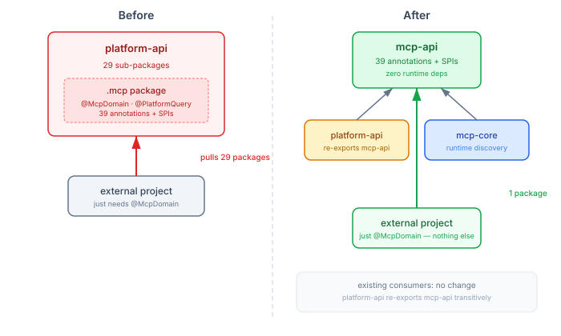

# The Annotation That Carried Too Much

`@McpDomain` is a single annotation. You put it on a Java interface, and the generator chain produces three surfaces from it: MCP tools for LLM navigation, REST endpoints for HTTP clients, and streaming endpoints for real-time data. One interface, three outputs, zero hand-written boilerplate.

The problem was where `@McpDomain` lived. It was inside `platform-api` — a module that also contains 29 sub-packages of SPIs for ACL, authentication, notifications, governance, capacity management, delivery channels, subscriptions, preferences, identity, and more. If an external project wanted to annotate a single interface with `@McpDomain`, it had to depend on the entire platform API.

This wasn't a runtime cost — `platform-api` is zero-dep, pure Java interfaces. But it was a conceptual cost. A project that just wants the tri-surface generator pattern shouldn't need to declare a dependency on a module named `casehub-platform-api` that implies commitment to the full CaseHub platform.

## Where annotations should live

The principle is old but worth restating: an annotation module should be the lightest dependency in your system. Annotations are compile-time contracts. The code that processes them — generators, scanners, runtime wiring — belongs in separate modules that can evolve independently.

Jakarta EE got this right: `jakarta.inject-api` is 4 classes. You can depend on it without depending on any implementation. Spring Boot's `spring-boot-autoconfigure-processor` is a build-time annotation processor with no runtime footprint. The annotation and the processing live in different JARs with different lifecycles.

CaseHub's `@McpDomain` had the opposite shape. The annotation lived inside the biggest module in the platform, and every project that wanted to use it inherited the full type surface.

## The extraction



We extracted 39 types — annotations, enums, records, and SPIs — from `platform-api` into a new `mcp-api` module. Same package (`io.casehub.platform.api.mcp`), different JAR. Zero import changes across the entire codebase.

The key design decisions:

**Package stays the same.** Moving to a different package would have required updating every import across every consumer — hundreds of files in multiple repositories. Since the types just moved from one JAR to another, and the package is unchanged, existing compiled code continues to work without recompilation.

**`platform-api` re-exports `mcp-api` transitively.** Any module that depends on `platform-api` still sees all the MCP types. No existing consumer needs a POM change. The extraction is invisible to internal code.

**`mcp-core` switches to `mcp-api` directly.** The runtime discovery module (`DomainModelRegistry`, tree navigation, search) only used two types from `platform-api` — `DomainReport` and `DomainReportProvider` — both from the `.mcp` package. After extraction, `mcp-core` depends on `mcp-api` with zero connection to the broader platform API.

## What this enables

An external project's dependency chain for the tri-surface pattern now looks like this:

```xml
<!-- Annotations — compile-time, zero transitive deps -->
<dependency>
    <groupId>io.casehub</groupId>
    <artifactId>casehub-mcp-api</artifactId>
</dependency>

<!-- Runtime — hierarchical discovery, tree navigation -->
<dependency>
    <groupId>io.casehub</groupId>
    <artifactId>casehub-mcp-core</artifactId>
</dependency>
```

Neither pulls in `platform-api`. Neither pulls in ACL, notifications, governance, or any of the 29 other sub-packages. The external project annotates its interfaces with `@McpDomain`, runs the generator plugin at build time, and gets MCP tools, REST endpoints, and streaming endpoints — all without any structural coupling to CaseHub's internal platform contracts.

That's the practical difference between "technically zero-dep" and "actually minimal." `platform-api` was technically zero-dep — pure Java, no heavy transitive dependencies. But it carried the full conceptual surface of the platform. `mcp-api` is both technically and conceptually minimal. It contains exactly what you need to use the annotation, and nothing else.
