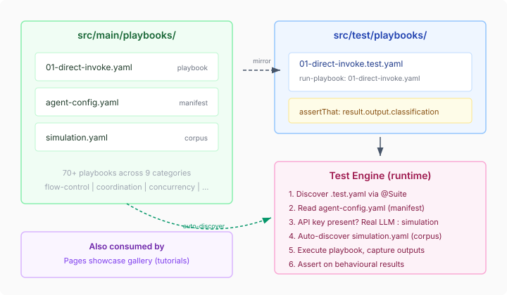

# The Test That Was Hiding in the Playbook

A playbook that can't prove it works isn't a tutorial — it's a promise. We had seventy playbooks across nine categories, each demonstrating a platform capability. Flow control, coordination primitives, concurrency patterns, agent interaction. They shipped as examples, rendered in the Pages showcase gallery, and were never tested at runtime.

The parsing gate caught structural errors — does the YAML parse, do the steps resolve. But it never ran them. A playbook could parse perfectly and fail on execution. The only playbooks with runtime tests were eight agent interaction patterns, tested by three Java classes with manual wiring: a hand-built `CorpusBackend`, a manually constructed `SessionPipeline`, raw SnakeYAML parsing, and forty-two hardcoded stub actions. Each test was a hundred-line ceremony that no one would copy for their own playbooks.

The gap was obvious once stated: the test framework should run playbooks, not reconstruct them.

## What changed

Three new plugins in `yaml-test-core` close the gap between "parses" and "works":

**`validate-playbook:`** compiles a playbook through `PlaybookCompiler` and returns structural metadata — step count, pool declarations, fork detection, salience values. In directory mode, it scans an entire tree of playbooks without a manifest. The old manifest was a hand-maintained JSON file with sixty-one entries, twelve of which had drifted from the front matter they duplicated. Nine playbooks weren't listed at all. The file system is the manifest now.

**`AgentSessionPlugins`** registers `agent-session-open`, `agent-query`, `agent-session-clear`, and `agent-session-close` as plugin definitions. These are the same session lifecycle steps that playbooks use — but registered in the plugin registry so `CatalogStepRunner` can execute them without the Java test's manual `InvokeHandler` wiring. A simulated corpus backend maps prompt patterns to canned responses.

**`AgentSessionTestSupport`** auto-wires the infrastructure when the test engine detects a `simulate.agent` block. It creates the `CorpusBackend`, builds the `SessionPipeline` with pool declarations from the playbook's own compilation result, registers the session plugins, and tears everything down after the test. The test author never sees any of this.

A compilation test that previously required Java:

```java
var result = compileExample("05-pool-backed.yaml");
assertThat(result.poolDeclarations()).hasSize(1);
assertThat(result.poolDeclarations().getFirst().name())
    .isEqualTo("analysts");
assertThat(result.poolDeclarations().getFirst().clearing())
    .containsEntry("policy", "size-aware");
```

becomes YAML:

```yaml
- validate-playbook: 05-pool-backed.yaml
  capture: result
- assertThat: result.poolDeclarations
  hasSize: 1
- assertThat: result.pools.analysts.name
  equals: "analysts"
```

No imports, no registry construction, no test infrastructure. The `assertThat` subject uses bare dot-path expressions — `result.pools.analysts.name` — resolved by a type-aware expression engine. No `${}` interpolation needed.

## The module that found its name

The playbooks lived in a module called `playbook-catalog`. The name implied a registry or index, not a home. We renamed it to `playbooks` — what it is, nothing more.

The examples that lived in a root `examples/` directory moved into `playbooks/src/main/playbooks/agent-interaction-patterns/`. They're catalog content, not a separate concern. Tests moved into `playbooks/src/test/playbooks/`, mirroring the main structure. One module, standard Maven layout, no path gymnastics.

This sounds like a trivial rename until you hit the circular dependency. `yaml-test-core` depends on `yaml-step-runtime`. `yaml-step-runtime` had a test dependency on `playbooks` (for the parsing gate). `playbooks` needs `yaml-test` for the test engine. Maven rejected the cycle. The fix: move `PlaybookParsingTest` from `yaml-step-runtime` into `playbooks`. It tested catalog content, not step runtime behaviour — it was in the wrong module. With that dependency removed, the cycle broke and the single-module structure worked.



## Surefire and the custom engine problem

The `YamlTestEngine` is a JUnit Platform `TestEngine` registered via ServiceLoader. It discovers `.test.yaml` files and runs them. In theory, Maven Surefire should invoke it automatically. In practice, Surefire only sends discovery requests for classes it already found through its own file scanner. No Java test classes, no discovery. This is [SUREFIRE-1724](https://github.com/apache/maven-surefire/issues/2065) — filed by the Cucumber maintainer, still open.

Cucumber's workaround is a `@Suite` annotation. Ours is the same — four lines:

```java
@Suite
@IncludeEngines("casehub-yaml")
@SelectDirectories("src/test/playbooks")
class RunPlaybookTests {}
```

No test logic. Pure declaration. Surefire sees the class, triggers the JUnit Platform, which invokes our engine, which discovers the YAML tests. Sixteen tests run, zero Java test code executed.

## What the exemplar looks like

The structure that other repos should copy:

```
playbooks/
  src/main/playbooks/
    agent-interaction-patterns/
      agent-config.yaml           # backend manifest
      simulation.yaml             # LLM corpus for dry-run
      01-direct-invoke.yaml       # the playbook
  src/test/playbooks/
    agent-interaction-patterns/
      compilation.test.yaml       # structural assertions
      execution.test.yaml         # runtime assertions
    catalog-parsing-gate.test.yaml
```

Main owns the content. Test validates the content. The mirror convention means tests resolve playbook paths against the corresponding main directory — `run-playbook: 01-direct-invoke.yaml` finds the right file without `../../../` traversal.

Simulation isn't just for LLMs. REST endpoints, GraphQL responses, any external dependency — the simulation framework handles all of them through the same corpus mechanism. Most playbook categories don't need simulation at all. Flow control, coordination, concurrency patterns — these use structural steps that work with stub actions out of the box. The LLM angle is one category among nine.

## What remains

Every playbook in the catalog should have a corresponding `.test.yaml` that validates it runs correctly. Eight out of seventy have that today. The framework is ready — the coverage isn't. That's mechanical work now, not infrastructure work. Each category gets its own `simulation.yaml` if it needs external call simulation, and a set of `.test.yaml` files asserting on behavioural outputs.

The playbooks are tutorials. The tests validate those tutorials. The Pages gallery renders them. Same source, three consumers, one gate: if the test doesn't pass, the tutorial doesn't ship.
